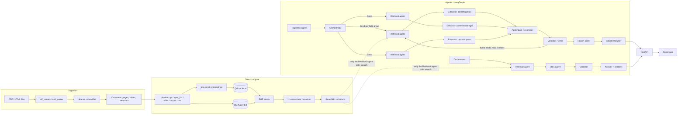

# RFP Intelligence Platform

Reads a bid folder (PDF + HTML, including addendums), indexes it in a hybrid
search engine, and runs a LangGraph multi-agent system that extracts 20 fields
per bid with citations, confidence and an addendum change log, and answers
free-form questions with citations. Everything is reachable from a CLI, a
FastAPI REST API and a React web app. It works on an unseen bid folder without
code changes.

```
data/<Bid>/*.pdf|*.html  ->  ingestion  ->  chunks  ->  Qdrant (dense) + BM25
                                                             |
   CLI / API / web app  <-  agents (LangGraph)  <-  hybrid search (RRF + re-ranker)
```

## Contents

1. [Setup](#setup)
2. [One-command run](#one-command-run)
3. [Every mode](#every-mode)
4. [Architecture](#architecture)
5. [Design decisions](#design-decisions)
6. [Results](#results)
7. [Deliverables](#deliverables)
8. [Assumptions and limitations](#assumptions-and-limitations)
9. [Repository tree](#repository-tree)

## Setup

Requirements: Python 3.10+ (developed on 3.12), Node 18+ (for the web app),
an OpenAI or Anthropic API key. The embedding model (`BAAI/bge-small-en-v1.5`)
and the cross-encoder (`cross-encoder/ms-marco-MiniLM-L-6-v2`) download once
from Hugging Face (~200 MB) and run locally on CPU; no key is needed for them.

```bash
python -m venv .venv
source .venv/bin/activate          # Windows: .venv\Scripts\activate  (Git Bash: source .venv/Scripts/activate)
pip install -r requirements.txt
cp .env.example .env               # then fill in LLM_PROVIDER, LLM_API_KEY, EXTRACT_MODEL, REASON_MODEL
pytest -q
```

`.env`:

```
LLM_PROVIDER=openai                # or anthropic
LLM_API_KEY=...
EXTRACT_MODEL=gpt-6-luna           # fast, low-cost: the three extractor agents
REASON_MODEL=gpt-6-sol             # stronger: reconciliation, validation, Q&A, summary
# LLM_DEV_CACHE=1                  # optional: cache identical LLM calls on disk while developing
```

All other settings live in `config/*.yaml` (`settings.yaml`: paths, chunking,
retrieval, agents, costs; `fields.yaml`: the 20 fields; `synonyms.yaml`:
query expansion; `ingestion.yaml`: HTML labels, filler patterns, classifier).

## One-command run

```bash
python main.py --bid ./data/Bid1
```

Indexes the folder (incrementally), runs the extraction graph and prints the
results table. Outputs: `outputs/Bid1.json` (the deliverable record),
`outputs/Bid1_summary.md`, `logs/trace_<run_id>.jsonl` (the agent trace).

## Every mode

| Mode | Command |
|---|---|
| Parse only | `python main.py parse --bid data/Bid1` -> `outputs/parsed/Bid1/*.json` + summary table |
| Index | `python main.py index --bid data/Bid1 [--force]` (second run adds 0 chunks) |
| Search | `python main.py search "due date" --bid Bid1 [--type addendum] [--addendum 2] [--top-k 5] [--config vector|hybrid|hybrid_rerank]` |
| Extract (graph) | `python main.py extract --bid data/Bid1` (`--baseline` runs the single-pass extractor instead) |
| Ask | `python main.py ask "What changed in Addendum 2?" --bid Bid1` or `python main.py --bid ./data/Bid1 --ask "..."` |
| Evaluate | `python main.py eval retrieval` -> `eval/results/retrieval.md`; `python main.py eval extraction` -> `eval/results/extraction.md` |
| API | `uvicorn rfp_intel.api.server:app --reload` -> http://localhost:8000/docs |
| Web app | `cd frontend && npm install && npm run dev` -> http://localhost:5173 (expects the API on :8000) |
| Frontend checks | `cd frontend && npm run lint && npm test && npm run build` |

Search queries can carry their own filters: a bid id ("Bid2"), "addendum 2",
or a scoped document type ("only search Bid2 specs processor", "in the RFP").

## Architecture



Agents communicate only through Pydantic models (`rfp_intel/schemas.py`):
`Plan`/`Task` (Orchestrator -> Retrieval), `EvidenceRequest`/`EvidenceBundle`
(Retrieval -> Extractors), `FieldExtraction` (LLM -> code), `FieldValue`,
`AddendumChange`, `ValidationResult`, `BidRecord`, `Answer`. The shared state
is `GraphState` (`rfp_intel/agents/state.py`). Every node is wrapped in
`@log_step`, which writes one `StepLog` line (input/output summaries, tool
calls incl. search queries and LLM calls, tokens, cost, latency, error) to
`logs/trace_<run_id>.jsonl`.

## Design decisions

### Chunking (why these sizes and units)

RFPs are not prose: the facts live in Q&A pairs, bullet spec lists, tables
and a portal record. The chunker (`rfp_intel/search/chunker.py`) keeps those
whole and only packs free text:

- **Special units, kept whole:** `qa` (an addendum question plus its
  "Answer:", even across a page break), `spec_list` (a "...Requirements"
  heading plus its bullets, skipping running page headers), `table` (rows as
  `a | b | c`, header row repeated when a table is split), `record` (the HTML
  bid page as one chunk). A cut Q&A pair or spec list is the most common way
  to lose an answer; keeping them whole is what makes `search "due date"`
  return the addendum chunk that actually contains the new date.
- **Free text:** paragraphs packed to **400 tokens** with **60 tokens of
  overlap** (`chunking` in settings.yaml). 400 tokens is one or two RFP
  clauses: large enough that a clause and its qualifier stay together, small
  enough that a cross-encoder scores one topic. The overlap keeps a sentence
  that straddles a cut retrievable from both sides. Chunks under 40 tokens
  are merged or dropped (except qa/record), so headings never become
  fragments.
- **Context header on every chunk** (`Bid1 | addendum 2 | file | p1 |
  section`): it is embedded and BM25-indexed with the text, so "addendum",
  the file name and the section help both retrievers, and it is what the
  LLM sees as the passage label.

### Embeddings and vector store

`BAAI/bge-small-en-v1.5` (384-d, local, fast on CPU, strong on short
retrieval queries; its query prefix is applied to queries only). Qdrant in
embedded local mode keeps the full `Chunk` as payload, so a hit is already a
citation (file, page, chunk id, text). Indexing is incremental: a manifest of
file hashes per bid skips unchanged bids and rebuilds changed ones without
duplicates.

### Retrieval strategy

1. **Filters parsed from the query** (bid id, "addendum N", scoped doc types)
   and merged with explicit filters (explicit wins).
2. **Query expansion** from `synonyms.yaml` (whole-phrase, up to 4 variants);
   each variant runs through both retrievers.
3. **Hybrid**: dense search (semantic paraphrases: "deadline" vs "closing
   date") plus **BM25** with an ID-preserving tokenizer (`JA-207652`,
   `WD22TB4`, `SI#` stay whole, and their parts are indexed too), which is
   what finds part numbers and solicitation ids.
4. **Reciprocal Rank Fusion** (k=60) merges the ranked lists without score
   calibration.
5. **Cross-encoder re-ranking** of the top 20 on (query, header + text).

`retrieval_configs` names three setups (`vector`, `hybrid`, `hybrid_rerank`)
for the evaluation and the `--config` flag.

### Agent framework and roles

LangGraph was chosen because the plan's control flow is a graph with a
loop: fan-out to three extractor branches (`Send`), a join at the
reconciler, and a validator feedback edge back to retrieval with a retry
cap. LangGraph gives that as declarative edges with typed shared state and
reducers, and nothing more (no hidden prompts, no agent chatter), which
keeps every LLM call visible in the trace.

| Agent (node) | Model | Does |
|---|---|---|
| Ingestion (`ingest`) | none | parses + indexes each bid (incremental) |
| Orchestrator (`orchestrate`) | none for extraction / REASON for questions | plan: 3 field-group tasks, or question type + bids + queries |
| Retrieval (`retrieve`) | none | **the only caller of the search engine**; evidence per field (+ addendum-only evidence), widened on retry |
| Extractors (`extract_<group>`) | EXTRACT | one structured call per group over numbered evidence; evidence ids -> citations with verified quotes |
| Addendum Reconciler (`reconcile`) | REASON | override / clarification / addition per field; latest addendum wins; old value kept in notes |
| Validator / Critic (`validate`) | REASON | rules (citation, quote-in-chunk, format, consistency incl. time zones) + support check; retries failed fields (max 2) |
| Report (`report`) | REASON | Bid Summary from validated fields only; writes the record |
| Q&A (`answer`, `validate_answer`) | REASON | cited answers or "Not found in documents"; comparison and change questions; one widened retry |

### Prompts and guardrails

Every prompt (`rfp_intel/agents/prompts/*.md`) states the role, "use ONLY
the evidence passages", "if the evidence does not contain the answer return
not_found and value null", "quote the exact supporting text" and the output
schema. Code enforces the rest: every LLM call goes through
`rfp_intel/llm.py` and returns a Pydantic model (strict JSON schema; invalid
output is retried once with the validation error, then fails the field, never
the run); unknown evidence ids are dropped; quotes must occur in the cited
chunk; a value without a citation is marked failed; missing information is
`null` + `not_found` + "Not found in documents".

### React stack

Vite + React 18 + TypeScript (strict) with Tailwind and shadcn/ui for small
typed components, TanStack Query for fetching/polling (`/runs/{id}` every
1.5 s during an extraction), React Router, Recharts for the evaluation
charts, react-markdown for answers. Types are generated from the API's
OpenAPI schema, so the UI cannot drift from the backend models.

## Results

### Retrieval (20 questions, bid-filtered, top_k = 10)

| config | Recall@1 | Recall@3 | Recall@5 | Recall@10 | MRR |
|---|---|---|---|---|---|
| vector | 0.650 | 0.750 | 0.850 | 0.900 | 0.723 |
| hybrid (vector + BM25, RRF) | 0.700 | 0.800 | 0.900 | 0.900 | 0.772 |
| hybrid_rerank (+ cross-encoder) | **0.800** | **0.900** | **1.000** | **1.000** | **0.858** |

Each step helps: BM25 lifts the ID questions (PORFP number, master contract,
`WD22TB4` are rank 1 in every config, but hybrid also recovers "Who is the
buyer?"), and the re-ranker fixes the two questions whose answer chunk is
semantically weak ("original solicitation due" = `27-JUN-2024` in a header
table; "Can bids be emailed?"). Per-question ranks:
[eval/results/retrieval.md](eval/results/retrieval.md).

### Extraction accuracy (19 scored fields per bid; Bid Summary judged, not counted)

| system | Bid1 exact / partial / wrong | Bid1 accuracy | Bid2 exact / partial / wrong | Bid2 accuracy |
|---|---|---|---|---|
| baseline (single pass) | 15 / 2 / 2 | 0.842 | 16 / 2 / 1 | 0.895 |
| multi-agent graph | 16 / 2 / 1 | **0.895** | 15 / 3 / 1 | 0.868 |

accuracy = (exact + 0.5 x partial) / 19, strict `must_contain` tokens plus an
LLM judge for free-text fields. The two systems share the extraction code,
so the per-bid differences are run-to-run variance of the models (they only
run at their default temperature); what the graph adds is structural: an
addendum change log (Bid1 Due Date: June 27 -> July 9, 2024, override),
validation with quote-verified citations (0 failed fields, every non-null
value cited), and a trace with explicit retries. Full tables:
[eval/results/extraction.md](eval/results/extraction.md) (graph) and
[eval/results/baseline/extraction.md](eval/results/baseline/extraction.md).

Validation counts of the delivered records: Bid1 17 passed / 0 failed /
3 not_found; Bid2 18 / 0 / 2. A run costs about $0.06-0.25 in LLM calls
(gpt-6-luna for the extractors, gpt-6-sol for the rest) and 2-6 minutes on
CPU, most of it retrieval.

### Unseen bid

With no Bid3 available, the pipeline was run unchanged on a third folder
(`data/MiniBid`, the synthetic fixture from `tests/fixtures/mini_bid`): it
indexed, extracted 9 fields with citations, marked 11 as not found and
recorded the fixture's addendum due-date override (`outputs/MiniBid.json`).

### Sample Q&A and trace

- Q&A log (12 cited answers, including the brief's five): [eval/qa_log.md](eval/qa_log.md)
- Example agent trace (Bid1, 25 steps incl. parallel extractors and two validator retries): [logs/example_trace.jsonl](logs/example_trace.jsonl)
- Requirements checklist: [docs/CHECKLIST.md](docs/CHECKLIST.md)
- Demo video script: [docs/DEMO_SCRIPT.md](docs/DEMO_SCRIPT.md)

## Deliverables

- `outputs/Bid1.json`, `outputs/Bid2.json` (+ `_summary.md`): 20 fields with value, sources, confidence, notes; addendum change log; validation counts.
- `eval/results/retrieval.md`, `eval/results/extraction.md`, `eval/qa_log.md`, `logs/example_trace.jsonl`.
- `docs/ASSUMPTIONS.md`: every decision the plan did not cover, numbered per phase.

## Assumptions and limitations

- The LLM models are reasoning models that only accept the default
  temperature; outputs can differ slightly between runs (the validator and
  the quote checks bound the effect). See `docs/ASSUMPTIONS.md` items 5-7.
- Scanned PDFs are detected (empty pages are flagged) but OCR is off by
  default (`ingestion.ocr.enabled`); enabling it needs Tesseract installed.
- Qdrant runs in embedded mode: one process may hold the index at a time
  (CLI and API should not index concurrently).
- Tables are extracted by pdfplumber only when they are ruled; layout grids
  are left as text.
- Chunk pages are the page a unit starts on; a quote may continue on the
  next page.

## Repository tree

```
main.py                 Typer CLI
config/                 settings.yaml fields.yaml synonyms.yaml ingestion.yaml
rfp_intel/
  config.py schemas.py logging_utils.py llm.py services.py
  ingestion/            loader pdf_parser html_parser cleaner classifier
  search/               chunker embedder vector_store bm25_store query fusion reranker engine
  agents/               state rules runtime baseline graph  prompts/*.md  nodes/*.py
  api/server.py         FastAPI
frontend/               React app
eval/                   questions, gold answers, loaders, eval runners, results/, qa_log.md
tests/                  pytest suite (fixtures/mini_bid generated by fixtures/make_mini_bid.py)
docs/                   BUILD_PLAN.md ASSUMPTIONS.md Assignment-AI_Engineer.pdf
data/ outputs/ logs/ storage/
```
