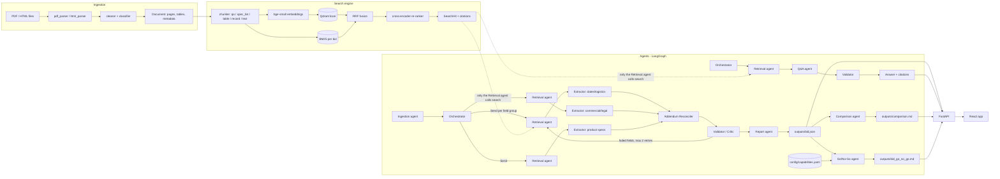

# RFP Intelligence Platform

Reads a bid folder (PDF + HTML, including addendums), indexes it in a hybrid
search engine, and runs a LangGraph multi-agent system that extracts 20 fields
per bid with citations, confidence and an addendum change log, and answers
free-form questions with citations. Two more agents compare bids side by
side and give a go / no-go recommendation against a configurable company
profile. Everything is reachable from a CLI, a FastAPI REST API and a React
web app, runs under Docker Compose, and is checked by CI. It works on an
unseen bid folder without code changes.

[](https://github.com/abhisheksaini3232/rfp_intel/actions/workflows/ci.yml)

```
data/<Bid>/*.pdf|*.html  ->  ingestion  ->  chunks  ->  Qdrant (dense) + BM25
                                                             |
   CLI / API / web app  <-  agents (LangGraph)  <-  hybrid search (RRF + re-ranker)
```

## Contents

1. [Setup](#setup)
2. [One-command run](#one-command-run)
3. [Every mode](#every-mode)
4. [Architecture](#architecture)
5. [Design decisions](#design-decisions)
6. [Results](#results)
7. [Bonus features](#bonus-features)
8. [Deliverables](#deliverables)
9. [Assumptions and limitations](#assumptions-and-limitations)
10. [Repository tree](#repository-tree)

## Setup

Requirements: Python 3.10+ (developed on 3.12), Node 18+ (for the web app),
an OpenAI or Anthropic API key. The embedding model (`BAAI/bge-small-en-v1.5`)
and the cross-encoder (`cross-encoder/ms-marco-MiniLM-L-6-v2`) download once
from Hugging Face (~200 MB) and run locally on CPU; no key is needed for them.

```bash
python -m venv .venv
source .venv/bin/activate          # Windows: .venv\Scripts\activate  (Git Bash: source .venv/Scripts/activate)
pip install -r requirements.txt
cp .env.example .env               # then fill in LLM_PROVIDER, LLM_API_KEY, EXTRACT_MODEL, REASON_MODEL
pytest -q
```

`.env`:

```
LLM_PROVIDER=openai                # or anthropic
LLM_API_KEY=...                    # key of LLM_PROVIDER
EXTRACT_MODEL=gpt-6-luna           # fast, low-cost: the three extractor agents
REASON_MODEL=gpt-5.4-mini          # stronger: reconciliation, validation, Q&A, summary
ANTHROPIC_API_KEY=...              # fallback: used automatically when LLM_API_KEY is missing or rejected
# LLM_DEV_CACHE=1                  # optional: cache identical LLM calls on disk while developing
# QDRANT_URL=http://localhost:6333 # only with vector_store.kind: qdrant_server (see "Running in production")
# RFP_SETTINGS_OVERLAY=config/docker.yaml   # optional yaml merged over config/settings.yaml
```

All other settings live in `config/*.yaml` (`settings.yaml`: paths, chunking,
retrieval, agents, costs; `fields.yaml`: the 20 fields; `synonyms.yaml`:
query expansion; `ingestion.yaml`: HTML labels, filler patterns, classifier).

**Provider fallback.** `config/settings.yaml` names a second provider
(`llm_fallback`: Anthropic by default, `claude-haiku-4-5` for the extractors
and `claude-opus-5` for reasoning). When the primary provider has no key, or
answers 401/403 to a call, every LLM call for the rest of the process goes to
the fallback with those models; the switch is logged once and `GET /health`
reports the active provider in `llm_provider`. Nothing else changes: the same
prompts, schemas and traces apply. Set the fallback's key in `.env`
(`ANTHROPIC_API_KEY`, or `OPENAI_API_KEY` when the primary is Anthropic).

## One-command run

```bash
python main.py --bid ./data/Bid1
```

Indexes the folder (incrementally), runs the extraction graph and prints the
results table. Outputs: `outputs/Bid1.json` (the deliverable record),
`outputs/Bid1_summary.md`, `logs/trace_<run_id>.jsonl` (the agent trace).

## Every mode

| Mode | Command |
|---|---|
| Parse only | `python main.py parse --bid data/Bid1` -> `outputs/parsed/Bid1/*.json` + summary table |
| Index | `python main.py index --bid data/Bid1 [--force]` (second run adds 0 chunks) |
| Search | `python main.py search "due date" --bid Bid1 [--type addendum] [--addendum 2] [--top-k 5] [--config vector|hybrid|hybrid_rerank]` |
| Extract (graph) | `python main.py extract --bid data/Bid1` (`--baseline` runs the single-pass extractor instead) |
| Ask | `python main.py ask "What changed in Addendum 2?" --bid Bid1` or `python main.py --bid ./data/Bid1 --ask "..."` |
| Compare bids | `python main.py compare Bid1 Bid2` -> `outputs/comparison.md` + `.json` (needs both records; two or more bids) |
| Go / no-go | `python main.py go-no-go --bid Bid1` -> `outputs/Bid1_go_no_go.md` + `.json` (judged against `config/capabilities.yaml`) |
| Evaluate | `python main.py eval retrieval [--min-recall5 0.9]` -> `eval/results/retrieval.md`; `python main.py eval extraction` -> `eval/results/extraction.md` |
| End-to-end smoke test | `python -m eval.smoke_e2e` (API running on :8001) -> `eval/results/smoke_e2e.md`; see [docs/TESTING.md](docs/TESTING.md) |
| API | `uvicorn rfp_intel.api.server:app --reload` -> http://localhost:8000/docs |
| Web app | `cd frontend && npm install && npm run dev` -> http://localhost:5173 (expects the API on :8000) |
| Frontend checks | `cd frontend && npm run lint && npm test && npm run build` |
| Tests | `pytest -q` (257 tests, no network or models needed) |
| CI | `.github/workflows/ci.yml`: pytest, frontend checks, retrieval eval with a recall@5 floor, on every push |
| Docker stack | `docker compose up --build` -> web app on :5173, API on :8001, Qdrant server on :6333 |
| Answer cache | `python main.py cache stats` / `python main.py cache clear` (semantic cache, `cache.enabled`) |

Search queries can carry their own filters: a bid id ("Bid2"), "addendum 2",
or a scoped document type ("only search Bid2 specs processor", "in the RFP").

## Architecture

Standalone diagrams (overview, extraction sequence, message table, processes):
[docs/ARCHITECTURE.md](docs/ARCHITECTURE.md).



Agents communicate only through Pydantic models (`rfp_intel/schemas.py`):
`Plan`/`Task` (Orchestrator -> Retrieval), `EvidenceRequest`/`EvidenceBundle`
(Retrieval -> Extractors), `FieldExtraction` (LLM -> code), `FieldValue`,
`AddendumChange`, `ValidationResult`, `BidRecord`, `Answer`, `ComparisonReport`,
`GoNoGoReport`. The shared state
is `GraphState` (`rfp_intel/agents/state.py`). Every node is wrapped in
`@log_step`, which writes one `StepLog` line (input/output summaries, tool
calls incl. search queries and LLM calls, tokens, cost, latency, error) to
`logs/trace_<run_id>.jsonl`.

## Design decisions

### Chunking (why these sizes and units)

RFPs are not prose: the facts live in Q&A pairs, bullet spec lists, tables
and a portal record. The chunker (`rfp_intel/search/chunker.py`) keeps those
whole and only packs free text:

- **Special units, kept whole:** `qa` (an addendum question plus its
  "Answer:", even across a page break), `spec_list` (a "...Requirements"
  heading plus its bullets, skipping running page headers), `table` (rows as
  `a | b | c`, header row repeated when a table is split), `record` (the HTML
  bid page as one chunk). A cut Q&A pair or spec list is the most common way
  to lose an answer; keeping them whole is what makes `search "due date"`
  return the addendum chunk that actually contains the new date.
- **Free text:** paragraphs packed to **400 tokens** with **60 tokens of
  overlap** (`chunking` in settings.yaml). 400 tokens is one or two RFP
  clauses: large enough that a clause and its qualifier stay together, small
  enough that a cross-encoder scores one topic. The overlap keeps a sentence
  that straddles a cut retrievable from both sides. Chunks under 40 tokens
  are merged or dropped (except qa/record), so headings never become
  fragments.
- **Context header on every chunk** (`Bid1 | addendum 2 | file | p1 |
  section`): it is embedded and BM25-indexed with the text, so "addendum",
  the file name and the section help both retrievers, and it is what the
  LLM sees as the passage label.

### Embeddings and vector store

`BAAI/bge-small-en-v1.5` (384-d, local, fast on CPU, strong on short
retrieval queries; its query prefix is applied to queries only). Qdrant in
embedded local mode keeps the full `Chunk` as payload, so a hit is already a
citation (file, page, chunk id, text). Indexing is incremental: a manifest of
file hashes per bid skips unchanged bids and rebuilds changed ones without
duplicates.

### Retrieval strategy

1. **Filters parsed from the query** (bid id, "addendum N", scoped doc types)
   and merged with explicit filters (explicit wins).
2. **Query expansion** from `synonyms.yaml` (whole-phrase, up to 4 variants);
   each variant runs through both retrievers.
3. **Hybrid**: dense search (semantic paraphrases: "deadline" vs "closing
   date") plus **BM25** with an ID-preserving tokenizer (`JA-207652`,
   `WD22TB4`, `SI#` stay whole, and their parts are indexed too), which is
   what finds part numbers and solicitation ids.
4. **Reciprocal Rank Fusion** (k=60) merges the ranked lists without score
   calibration.
5. **Cross-encoder re-ranking** of the top 20 on (query, header + text).

`retrieval_configs` names three setups (`vector`, `hybrid`, `hybrid_rerank`)
for the evaluation and the `--config` flag.

The Retrieval agent asks for all of a request's queries at once
(`SearchEngine.search_many`): every query and synonym variant contributes a
dense and a BM25 list to one fusion, and the cross-encoder runs once over the
fused top 20. Query embeddings are batched and memoised. The first fused
search of a question costs about 4 s on CPU; the API warms both models at
startup so no request pays the ~30 s model load.

### Running in production

The defaults are a single-process developer setup: embedded Qdrant under
`storage/`, local models on CPU, `POST /ask` answered inline. The same code
runs a multi-process deployment with three switches, all in
`config/settings.yaml` (or an overlay file named by `RFP_SETTINGS_OVERLAY`,
such as the shipped `config/docker.yaml`):

| Switch | Development | Production |
|---|---|---|
| `vector_store.kind` | `qdrant_local` (one process may hold the index) | `qdrant_server` + `QDRANT_URL` in `.env`: any number of API processes share one index and payload indexes take effect |
| `embedding.provider` | `local` (`BAAI/bge-small-en-v1.5`) | `openai` (`embedding.model: text-embedding-3-small`, uses `LLM_API_KEY`): no torch on the API host; switching re-indexes because the manifest keys on the model |
| `reranker.enabled` / `max_passages` | `true` / 20 | keep on for accuracy; lower `max_passages` or disable to trade recall@1 for latency |
| `embedding.torch_threads` | 0 (torch default) | the CPU share per process when several workers share one host |
| `api.ask_workers` / `ask_queue_max` | 2 / 8 | sized to the host; the API answers 429 when the queue is full |

Questions from the web app run in the background (`POST /ask/runs`, polled
through `GET /runs/{id}`) with a soft timeout (`agents.qa_timeout_s`), so a
slow question never blocks the server; extraction keeps its one-at-a-time
lock because it rewrites the index. A **semantic answer cache**
(`cache.enabled`, on by default) stores every found answer in a second Qdrant
collection keyed by the question's embedding and the bid scope; an equivalent
question (cosine >= `cache.similarity_threshold`) is answered instantly with a
"cached" badge, and re-indexing a bid invalidates its entries. `GET /metrics`
reports run counts and p50/p95 latency per kind, the question queue and
cache hits/misses for the process; every finished run also logs one
`run done kind=... duration_ms=...` line, and `GET /runs/{id}` carries a
`summary` (steps, latency, tokens, cost, LLM calls, searches, errors). `docker compose up --build` starts a
Qdrant server, the API (with `config/docker.yaml` applied) and the built web
app; index a bid against the server with
`RFP_SETTINGS_OVERLAY=config/docker.yaml QDRANT_URL=http://localhost:6333 python main.py index --bid data/Bid1`.

### Agent framework and roles

LangGraph was chosen because the plan's control flow is a graph with a
loop: fan-out to three extractor branches (`Send`), a join at the
reconciler, and a validator feedback edge back to retrieval with a retry
cap. LangGraph gives that as declarative edges with typed shared state and
reducers, and nothing more (no hidden prompts, no agent chatter), which
keeps every LLM call visible in the trace.

| Agent (node) | Model | Does |
|---|---|---|
| Ingestion (`ingest`) | none | parses + indexes each bid (incremental) |
| Orchestrator (`orchestrate`) | none for extraction / REASON for questions | plan: 3 field-group tasks, or question type + bids + queries |
| Retrieval (`retrieve`) | none | **the only caller of the search engine**; evidence per field (+ addendum-only evidence), widened on retry |
| Extractors (`extract_<group>`) | EXTRACT | one structured call per group over numbered evidence; evidence ids -> citations with verified quotes |
| Addendum Reconciler (`reconcile`) | REASON | override / clarification / addition per field; latest addendum wins; old value kept in notes |
| Validator / Critic (`validate`) | REASON | rules (citation, quote-in-chunk, format, consistency incl. time zones) + support check; retries failed fields (max 2) |
| Report (`report`) | REASON | Bid Summary from validated fields only; writes the record |
| Q&A (`answer`, `validate_answer`) | REASON | cited answers or "Not found in documents"; comparison and change questions; one widened retry |
| Comparison (`compare`, bonus) | REASON | rows per field from the saved records (`differs` computed in code), narrative + highlights written from the validated values only, citations inherited from the cells |
| Go/No-Go (`go_no_go`, bonus) | REASON | one met / not_met / unknown verdict per criterion of `config/capabilities.yaml` from the fields it names; criteria with no stated value are decided by rule; the recommendation (go / no_go / review) is code |

### Prompts and guardrails

Every prompt (`rfp_intel/agents/prompts/*.md`) states the role, "use ONLY
the evidence passages", "if the evidence does not contain the answer return
not_found and value null", "quote the exact supporting text" and the output
schema. Code enforces the rest: every LLM call goes through
`rfp_intel/llm.py` and returns a Pydantic model (strict JSON schema; invalid
output is retried once with the validation error, then fails the field, never
the run); unknown evidence ids are dropped; quotes must occur in the cited
chunk; a value without a citation is marked failed; missing information is
`null` + `not_found` + "Not found in documents".

### React stack

Vite + React 18 + TypeScript (strict) with Tailwind and shadcn/ui for small
typed components, TanStack Query for fetching/polling (`/runs` and `/runs/{id}`
every 1.5 s during an extraction, so a run started elsewhere or before a
reload is picked up and other bids show "Busy"), React Router, Recharts for the evaluation
charts, react-markdown for answers. Types are generated from the API's
OpenAPI schema, so the UI cannot drift from the backend models.

## Results

### Retrieval (20 questions, bid-filtered, top_k = 10)

| config | Recall@1 | Recall@3 | Recall@5 | Recall@10 | MRR |
|---|---|---|---|---|---|
| vector | 0.650 | 0.750 | 0.850 | 0.900 | 0.723 |
| hybrid (vector + BM25, RRF) | 0.700 | 0.800 | 0.900 | 0.900 | 0.772 |
| hybrid_rerank (+ cross-encoder) | **0.800** | **0.900** | **1.000** | **1.000** | **0.858** |

Each step helps: BM25 lifts the ID questions (PORFP number, master contract,
`WD22TB4` are rank 1 in every config, but hybrid also recovers "Who is the
buyer?"), and the re-ranker fixes the two questions whose answer chunk is
semantically weak ("original solicitation due" = `27-JUN-2024` in a header
table; "Can bids be emailed?"). Per-question ranks:
[eval/results/retrieval.md](eval/results/retrieval.md).

### Extraction accuracy (19 scored fields per bid; Bid Summary judged, not counted)

| system | Bid1 exact / partial / wrong | Bid1 accuracy | Bid2 exact / partial / wrong | Bid2 accuracy |
|---|---|---|---|---|
| baseline (single pass) | 15 / 2 / 2 | 0.842 | 16 / 2 / 1 | 0.895 |
| multi-agent graph | 15 / 3 / 1 | **0.868** | 16 / 2 / 1 | **0.895** |

accuracy = (exact + 0.5 x partial) / 19, strict `must_contain` tokens plus an
LLM judge for free-text fields. The two systems share the extraction code,
so the per-bid differences are run-to-run variance of the models (they only
run at their default temperature); what the graph adds is structural: an
addendum change log (Bid1 Due Date: June 27 -> July 9, 2024, override),
validation with quote-verified citations (every non-null value cited;
fields that fail the support check keep their value but are marked), and a trace with explicit retries. Full tables:
[eval/results/extraction.md](eval/results/extraction.md) (graph) and
[eval/results/baseline/extraction.md](eval/results/baseline/extraction.md).

Validation counts of the delivered records: Bid1 13 passed / 2 failed /
5 not_found (the two failed fields are long lists that keep their values
and citations but did not pass the strict support check); Bid2 17 / 1 / 2. A run costs about $0.03-0.07 in LLM calls
(gpt-6-luna for the extractors, gpt-5.4-mini for reconciliation, validation,
Q&A and the summary; see docs/ASSUMPTIONS.md 86 for the model choice) and
2-6 minutes on CPU, most of it retrieval.

### Unseen bid

With no Bid3 available, the pipeline was run unchanged on a third folder
(`data/MiniBid`, the synthetic fixture from `tests/fixtures/mini_bid`): it
indexed, extracted 9 fields with citations, marked 11 as not found and
recorded the fixture's addendum due-date override (`outputs/MiniBid.json`).

### Sample Q&A and trace

- Q&A log (12 cited answers, including the brief's five): [eval/qa_log.md](eval/qa_log.md)
- Example agent trace (Bid1, 25 steps incl. parallel extractors and two validator retries): [logs/example_trace.jsonl](logs/example_trace.jsonl)
- Requirements checklist: [docs/CHECKLIST.md](docs/CHECKLIST.md)
- Demo video script: [docs/DEMO_SCRIPT.md](docs/DEMO_SCRIPT.md)
- Backend walkthrough with diagrams: [docs/BACKEND.md](docs/BACKEND.md)

## Bonus features

| Bonus | Status | Where |
|---|---|---|
| Web UI for search and chat | done | `frontend/` (React): Bids, Bid detail with citation drawer, Search, Ask, Compare, Evaluation, Run trace |
| OCR for scanned PDFs | done, off by default | `ingestion.ocr.enabled` with pytesseract; scanned pages are detected and logged either way (needs Tesseract installed) |
| Bid comparison agent | done | `python main.py compare Bid1 Bid2`, `POST /compare`, Compare page -> [outputs/comparison.md](outputs/comparison.md) |
| Go / no-go recommendation | done | `config/capabilities.yaml` (company profile) + `python main.py go-no-go --bid Bid1`, `POST /bids/{id}/go-no-go`, Go / no-go tab -> [outputs/Bid1_go_no_go.md](outputs/Bid1_go_no_go.md), [outputs/Bid2_go_no_go.md](outputs/Bid2_go_no_go.md) |
| Semantic caching + cost/latency per run | done | `cache.enabled` (answers keyed by question embedding + bid scope, invalidated on re-index); tokens, cost and latency per step in every trace, `summary` on `GET /runs/{id}`, `GET /metrics` |
| Docker + CI | done | `docker-compose.yml` (Qdrant + API + web), `.github/workflows/ci.yml` (pytest, frontend lint/test/build, retrieval eval gate) |

The comparison and go/no-go agents work from the saved records, so both bids
must be extracted first. The go/no-go profile shipped here is a sample
company (authorized manufacturers, delivery window, bonding capacity, served
regions, term policy, submission methods, cooperatives); edit it for yours.
Each criterion names the fields it is judged on, is `critical` or not, and
says what to conclude when the bid states nothing (`when_not_found`). The
recommendation is deterministic: `no_go` on a critical miss, `review` when
something is unknown or a non-critical criterion fails, `go` otherwise.

## Deliverables

Mapped to the assignment brief:

| Deliverable | Where |
|---|---|
| Source code: ingestion, RAG search engine, multi-agent system, API/CLI | `rfp_intel/ingestion`, `rfp_intel/search`, `rfp_intel/agents`, `rfp_intel/api`, `main.py` |
| README: setup, dependencies, modes, design decisions | this file (chunking, embeddings, retrieval, agent framework, prompts above) |
| Architecture diagram | [docs/ARCHITECTURE.md](docs/ARCHITECTURE.md) and the diagram above |
| JSON output per bid (values, citations, confidence) | [outputs/Bid1.json](outputs/Bid1.json), [outputs/Bid2.json](outputs/Bid2.json) (+ `_summary.md`; `outputs/MiniBid.json` for the unseen-bid check) |
| Retrieval evaluation report (question set, Recall@k / MRR per config) | [eval/results/retrieval.md](eval/results/retrieval.md) (questions in `eval/retrieval_questions.jsonl`) |
| Sample Q&A log (>= 10 questions) | [eval/qa_log.md](eval/qa_log.md) (12 cited answers) |
| Agent trace (one full extraction run) | [logs/example_trace.jsonl](logs/example_trace.jsonl) |
| Demo video | script in [docs/DEMO_SCRIPT.md](docs/DEMO_SCRIPT.md); recording to be attached to the submission |
| Assumptions and known limitations | next section and [docs/ASSUMPTIONS.md](docs/ASSUMPTIONS.md) (numbered per phase) |
| Requirements checklist | [docs/CHECKLIST.md](docs/CHECKLIST.md); testing guide [docs/TESTING.md](docs/TESTING.md); extraction eval [eval/results/extraction.md](eval/results/extraction.md); smoke test [eval/results/smoke_e2e.md](eval/results/smoke_e2e.md) |

## Assumptions and limitations

- The LLM models are reasoning models that only accept the default
  temperature; outputs can differ slightly between runs (the validator and
  the quote checks bound the effect). See `docs/ASSUMPTIONS.md` items 5-7.
- Scanned PDFs are detected (empty pages are flagged) but OCR is off by
  default (`ingestion.ocr.enabled`); enabling it needs Tesseract installed.
- With the default `vector_store.kind: qdrant_local` one process may hold
  the index at a time (CLI and API should not run concurrently); use
  `qdrant_server` for several processes (see "Running in production").
- A background question past `agents.qa_timeout_s` is reported as failed but
  its thread runs to completion; Python threads cannot be interrupted.
- Tables are extracted by pdfplumber only when they are ruled; layout grids
  are left as text.
- Chunk pages are the page a unit starts on; a quote may continue on the
  next page.
- The comparison and go/no-go agents reason over the extracted values, not
  the documents again: a value the extractor missed stays "Not found" in the
  comparison and makes its criterion `unknown`. The go/no-go verdicts depend
  on the capability profile you write; the shipped one is a sample.
- The validator's support check is strict on long list-valued fields
  (documentation lists, multi-tier specifications): such a field can end up
  `failed` while still carrying its value and citations, so the counts in
  the record are a lower bound on what was extracted.
- CI runs the retrieval evaluation only; the extraction evaluation needs an
  LLM key and is run locally (`python main.py eval extraction`).

## Repository tree

```
main.py                 Typer CLI
config/                 settings.yaml fields.yaml synonyms.yaml ingestion.yaml capabilities.yaml docker.yaml
rfp_intel/
  config.py schemas.py logging_utils.py llm.py services.py
  ingestion/            loader pdf_parser html_parser cleaner classifier
  search/               chunker embedder vector_store bm25_store query fusion reranker engine
  agents/               state rules runtime baseline graph  prompts/*.md  nodes/*.py (incl. compare, go_no_go)
  api/server.py         FastAPI
frontend/               React app
eval/                   questions, gold answers, loaders, eval runners, smoke_e2e.py, results/, qa_log.md
tests/                  pytest suite (fixtures/mini_bid generated by fixtures/make_mini_bid.py)
docs/                   BUILD_PLAN.md ARCHITECTURE.md TESTING.md CHECKLIST.md DEMO_SCRIPT.md ASSUMPTIONS.md BACKEND.md
.github/workflows/      ci.yml
Dockerfile docker-compose.yml frontend/Dockerfile
data/ outputs/ logs/ storage/
```
