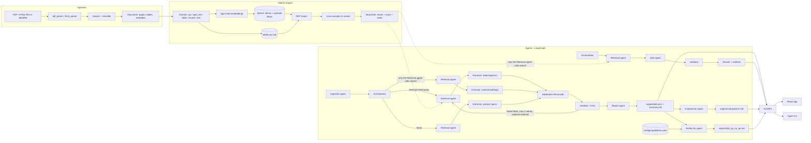
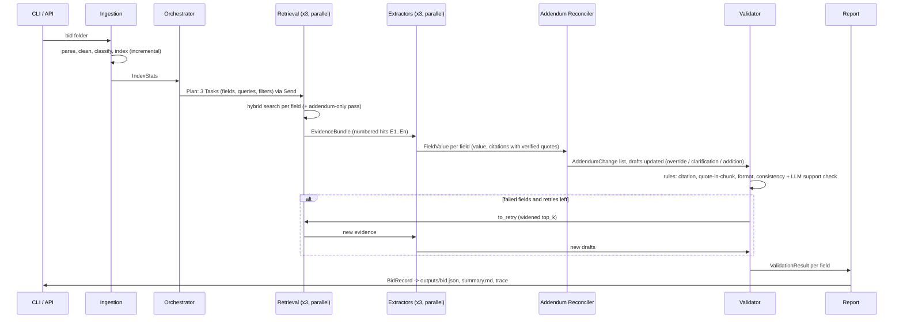
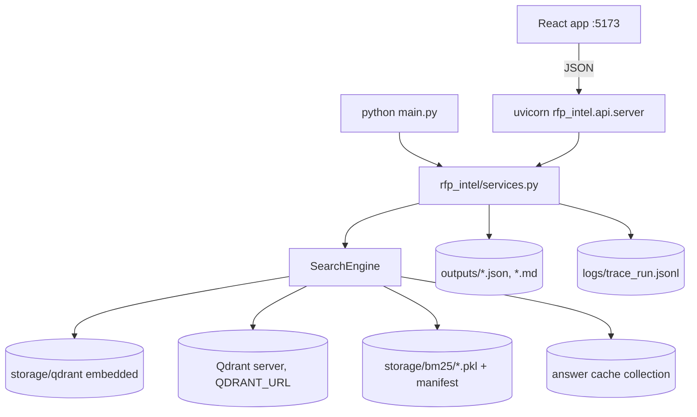

# Architecture

The search engine, the agents and how they communicate. GitHub renders the
Mermaid diagrams inline; `docs/BACKEND.md` walks through the same code in
more detail.

## 1. System overview

## 2. Extraction run (sequence)

## 3. Messages between agents

Every message is a Pydantic model in `rfp_intel/schemas.py`; nodes share one
typed `GraphState` (`rfp_intel/agents/state.py`) whose dict/list fields have
reducers so parallel branches merge instead of overwriting.

| From -> To | Model | Carries |
|---|---|---|
| Orchestrator -> Retrieval | `Plan` / `Task` | field group, field names, queries, `SearchFilters` |
| Retrieval -> Extractor / Q&A | `EvidenceRequest` -> `EvidenceBundle` | numbered `SearchHit`s (chunk, score, ranks) |
| LLM -> Extractor (code) | `FieldExtractions` | value, evidence ids, quotes, status, notes |
| Extractor -> Reconciler -> Validator | `FieldValue` | value, `Citation`s (file, page, chunk_id, quote), confidence, notes, status |
| Reconciler -> Report | `AddendumChange` | field, kind, old/new value, addendum number, source |
| Validator -> Report | `ValidationResult` | per-field checks and reason |
| Report -> API/CLI | `BidRecord` | the deliverable JSON |
| Q&A -> API/CLI | `Answer` | answer text, citations, confidence, bids, cached flag |
| Comparison -> API/CLI | `ComparisonReport` | rows (cell per bid, `differs`), narrative, highlights with citations |
| Go/No-Go -> API/CLI | `GoNoGoReport` | recommendation, criterion verdicts with citations |
| every node -> trace | `StepLog` | input/output summaries, tool calls, tokens, cost, latency, error |

Rules enforced by code, not prompts: only the Retrieval node calls the search
engine; every LLM call goes through `rfp_intel/llm.py` and returns a Pydantic
model; a value without a citation is marked failed; a quote that is not in its
cited chunk fails validation; missing information is `null` + `not_found` +
"Not found in documents".

## 4. Processes and storage

Development uses the embedded store (one process at a time); `docker compose
up` runs a Qdrant server, the API and the built web app, and the CI workflow
(`.github/workflows/ci.yml`) runs the tests, the frontend checks and the
retrieval evaluation on every push.
