# Backend: what happens, where, and in which order

This document walks through the Python backend of the RFP Intelligence
Platform end to end: the files involved, the data that flows between them,
and the decisions taken at each step. Diagrams are Mermaid (rendered by
GitHub and most editors).

Contents

1. [Big picture](#1-big-picture)
2. [Module map](#2-module-map)
3. [Configuration and secrets](#3-configuration-and-secrets)
4. [Data models](#4-data-models)
5. [Ingestion: file -> Document](#5-ingestion-file---document)
6. [Chunking: Document -> Chunks](#6-chunking-document---chunks)
7. [Indexing: Chunks -> Qdrant + BM25 (incremental)](#7-indexing-chunks---qdrant--bm25-incremental)
8. [Search: query -> SearchHits](#8-search-query---searchhits)
9. [LLM wrapper](#9-llm-wrapper)
10. [Extraction graph (multi-agent)](#10-extraction-graph-multi-agent)
11. [Q&A graph](#11-qa-graph)
12. [Observability: the trace](#12-observability-the-trace)
13. [Services, CLI and API](#13-services-cli-and-api)
14. [Error handling](#14-error-handling)
15. [Evaluation](#15-evaluation)
16. [Storage layout on disk](#16-storage-layout-on-disk)
17. [Extending the backend](#17-extending-the-backend)

---

## 1. Big picture

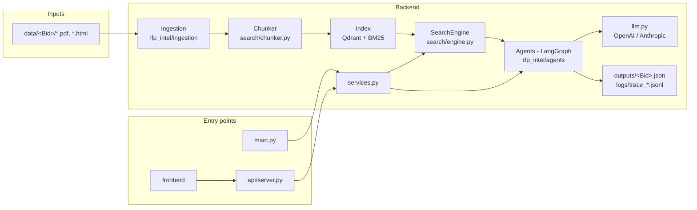

Three layers, one direction of dependency:

| layer | package | depends on | never does |
|---|---|---|---|
| ingestion | `rfp_intel/ingestion` | config, schemas | call an LLM, touch the index |
| search | `rfp_intel/search` | ingestion, config, schemas | call an LLM |
| agents | `rfp_intel/agents` | search (only through the Retrieval node), llm, schemas | read files directly (except saved records for change questions) |

`services.py` is the only module the CLI and the API call; they contain no logic of their own.

---

## 2. Module map

```
rfp_intel/
  config.py           Settings (config/*.yaml + .env), load_fields(), load_synonyms(), load_ingestion()
  schemas.py          every Pydantic model exchanged between modules and agents
  logging_utils.py    StepLog JSONL writer, @log_step decorator, record_tool_call / record_llm_call
  llm.py              structured() and text(): provider-agnostic LLM calls returning Pydantic models
  services.py         functions shared by CLI and API
  ingestion/
    loader.py         load_bid_folder(): per-file hashing, dispatch, classify, clean, title, date
    pdf_parser.py     parse_pdf(): PyMuPDF spans -> lines, pdfplumber tables, empty pages, OCR
    html_parser.py    parse_html(): label/value extraction from portal pages
    cleaner.py        clean_pages(): headers/footers, filler lines, hyphenation, whitespace
    classifier.py     classify(): doc type + addendum number; extract_doc_date()
  search/
    chunker.py        chunk_document(): qa / spec_list / table / record / text chunks
    embedder.py       Embedder: bge-small, normalized vectors, query prefix
    vector_store.py   VectorStore: Qdrant local, payload = Chunk, filters
    bm25_store.py     BM25Store + tokenize(): one corpus per bid, ID-preserving tokens
    query.py          expand_query() (synonyms), parse_filters() (bid / addendum / scoped doc type)
    fusion.py         rrf(): reciprocal rank fusion
    reranker.py       Reranker: cross-encoder
    engine.py         SearchEngine: index_bid() with manifest, search() pipeline
  agents/
    state.py          GraphState (TypedDict + reducers)
    runtime.py        shared engine (one Qdrant client per process), prompt loading
    rules.py          deterministic validator rules (citation, quote, format, consistency, time zones)
    baseline.py       single-pass extractor + the citation/quote helpers the graph reuses
    graph.py          build_extraction_graph(), build_qa_graph(), run_extraction(), run_question()
    prompts/*.md      orchestrator, extract, reconcile, validate, summary, answer
    nodes/            ingest, orchestrate, retrieve, extract, reconcile, validate, report, answer
  api/server.py       FastAPI app
```

---

## 3. Configuration and secrets

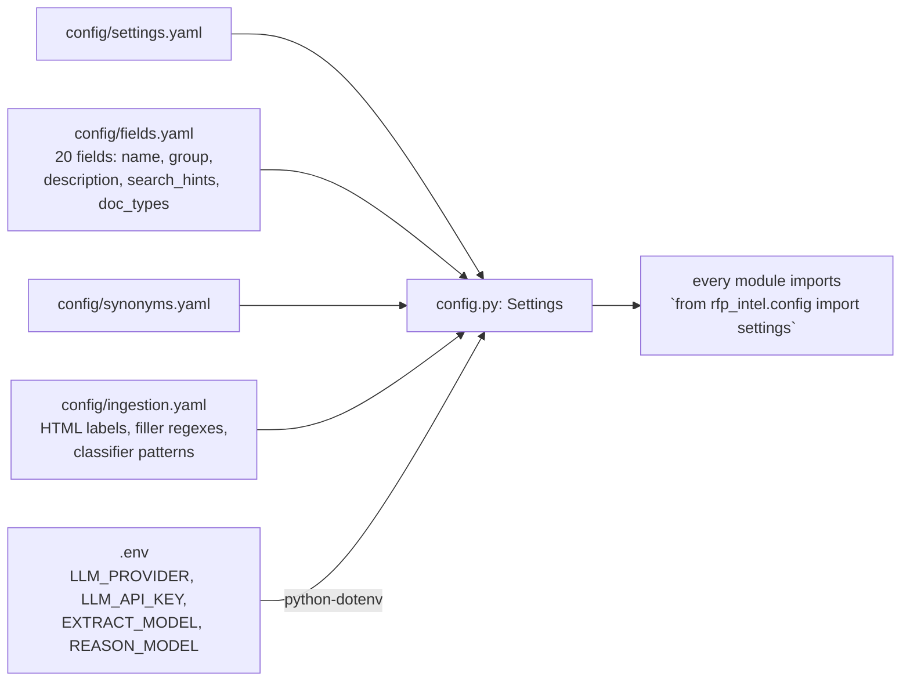

- `settings` is a typed Pydantic object; `settings.retrieval_for("hybrid")`
  applies a named retrieval config; `settings.path("outputs_dir")` resolves
  paths against the project root.
- The API key is a `SecretStr` and is never logged or printed. Only `.env`
  holds secrets; `.gitignore` excludes it.
- `fields.yaml` drives everything field-related: the extractor groups, the
  retrieval queries (description + search_hints), the optional doc-type
  narrowing, and the `BidRecord` validator that insists on exactly those 20
  names. Adding a field is a config change.

---

## 4. Data models

All in `rfp_intel/schemas.py`. No raw dicts cross a module boundary.

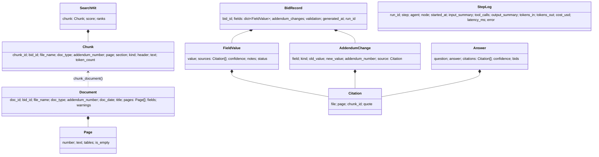

Agent-to-agent messages: `Plan`/`Task` (Orchestrator -> branches),
`EvidenceRequest`/`EvidenceBundle` (Retrieval -> Extractors / Reconciler /
Q&A), `FieldExtraction(s)` (extractor LLM output), `ReconcileDecision(s)`,
`SupportCheck(s)`, `QAPlan`, `AnswerDraft` (LLM outputs), `ValidationResult`.

---

## 5. Ingestion: file -> Document

Entry point: `load_bid_folder(folder)` in `ingestion/loader.py`. No LLM.

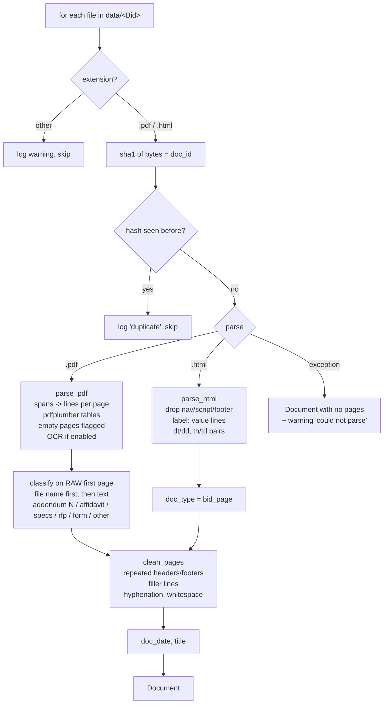

Details that matter:

- **PDF text is rebuilt from spans** (not `get_text()`): spans are grouped
  into rows by vertical position and joined with a space where there is a
  visible horizontal gap, so side-by-side columns ("part number | description")
  do not run together. A larger vertical gap becomes a paragraph break.
- **Classification happens before cleaning** because the cleaner removes
  repeated lines such as "ADDENDUM No. 1" that the classifier needs.
- **Cleaner rules:** a line is a header/footer if it repeats on >= 50% of
  pages (digits treated as wildcards, so "Page 3 of 40" == "Page 4 of 40"),
  is >= 4 chars and contains letters. Filler regexes come from
  `ingestion.yaml`. "procure-\nment" is joined; "JA-\n207652" is not.
- **Failures never stop the run:** unreadable, empty, encrypted or scanned
  files become Documents with warnings; the warnings reach the CLI table,
  `IndexStats.warnings` and `/bids/{id}`.

CLI: `python main.py parse --bid data/Bid1` writes `outputs/parsed/<bid>/<file>.json`.

---

## 6. Chunking: Document -> Chunks

`chunk_document(doc)` in `search/chunker.py`. The document is processed as
one stream of lines (page breaks are kept as markers), so units that cross a
page keep their text; `page` = the page a chunk starts on.

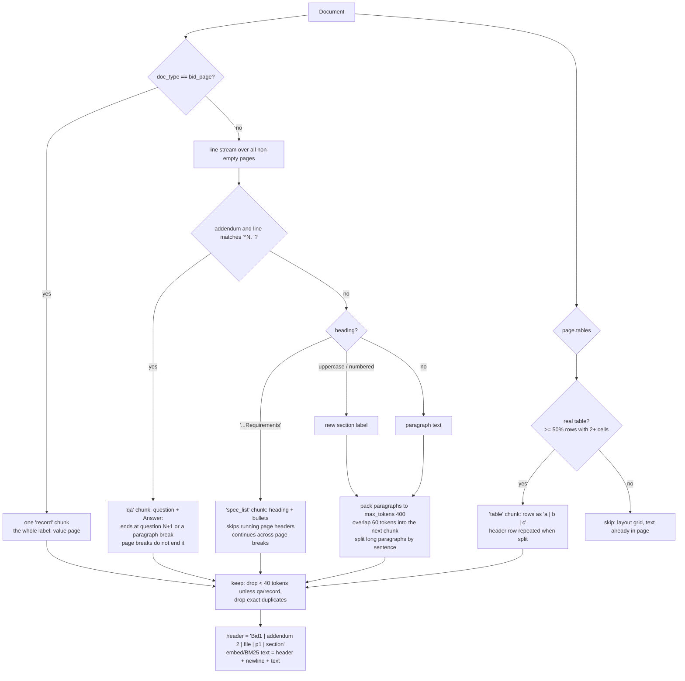

Why: RFP facts live in Q&A pairs, bullet spec lists, tables and the portal
record; cutting any of those in half is the most common way to lose an
answer. Free text gets 400-token windows with 60 tokens of overlap so a
clause and its qualifier stay together and a sentence on a cut is
retrievable from both sides. The header gives every chunk its own context
(bid, document type, file, page, section) for both retrievers and the LLM.

---

## 7. Indexing: Chunks -> Qdrant + BM25 (incremental)

`SearchEngine.index_bid(folder, force=False)` in `search/engine.py`.

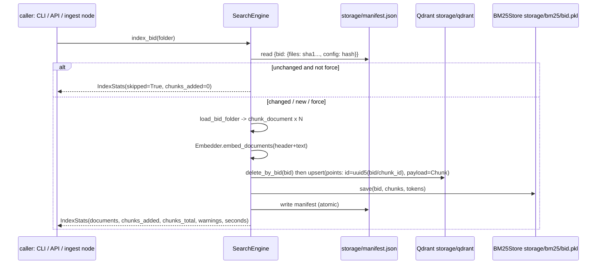

- The manifest hashes every supported file and the chunking/embedding
  settings, so a changed file or changed chunk size re-indexes that bid
  only, and a second run adds 0 chunks.
- Point ids are `uuid5(bid_id/chunk_id)`: the same file in two bids (a
  standard affidavit) does not overwrite itself.
- Qdrant runs in embedded local mode: one client per storage folder per
  process. `agents/runtime.get_engine()` hands out the single shared engine;
  the API opens it in its lifespan, the CLI closes it after each command.
- The vector size is cached in the manifest so skipping an unchanged bid does
  not load the embedding model (~1 s instead of ~15 s).

---

## 8. Search: query -> SearchHits

`SearchEngine.search(query, filters=None, top_k=None, config=None)`.

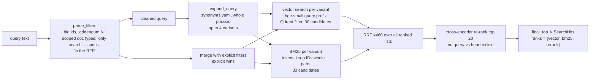

Named configs (`retrieval_configs` in settings.yaml): `vector` (dense only),
`hybrid` (dense + BM25 + RRF), `hybrid_rerank` (+ cross-encoder, the
default). The evaluation runs all three.

Notes:

- The BM25 tokenizer keeps `JA-207652`, `WD22TB4`, `SI#` whole and also
  emits their parts, so both "207652" and the full id match. BM25 results
  are "contains a query token, ranked by score" rather than "score > 0",
  because in small corpora a term present in half the chunks gets IDF 0.
- Multi-bid searches build one BM25 over the selected bids at query time so
  scores are comparable across bids.
- Doc-type words only become filters with scoping phrasing: "Which affidavit
  concerns mercury?" is a topic (the answer is in the PORFP), "only search
  Bid2 specs" is a scope.

CLI: `python main.py search "WD22TB4" --bid Bid2 --config hybrid_rerank`.
API: `GET /search?q=...&bid_id=...&doc_type=...&addendum=...&top_k=...&config=...`.

---

## 9. LLM wrapper

`rfp_intel/llm.py`: the only place that talks to a model.

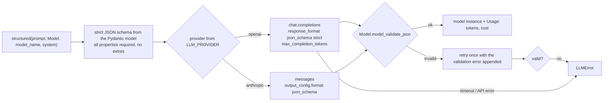

- Temperature is sent from config; if a model rejects it (reasoning models
  only accept their default) the call is retried without it and the model
  is remembered.
- Every call records tokens, latency and cost (prices per model in
  `settings.yaml` `cost`) into the current trace step via
  `record_llm_call`.
- `LLM_DEV_CACHE=1` caches identical calls on disk for development.
- Models with open-ended dicts cannot use strict mode; they fall back to a
  schema hint in the system prompt plus the same validation.

---

## 10. Extraction graph (multi-agent)

`build_extraction_graph()` in `agents/graph.py`. Run with
`python main.py --bid ./data/Bid1` (`run_extraction(bid_id)`).

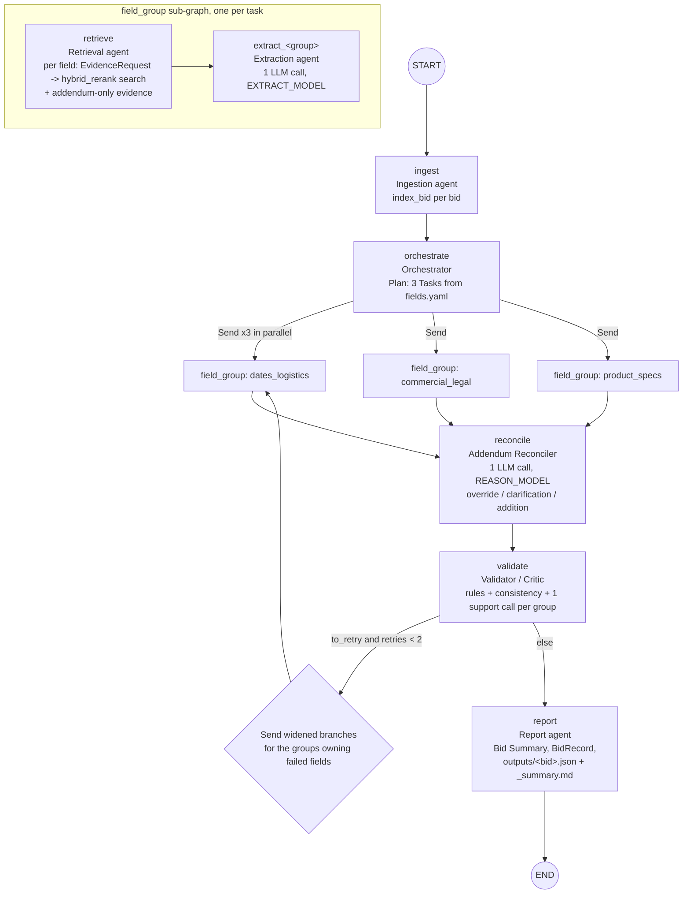

State keys written by each node (reducers merge dicts/lists from parallel branches):

| node | reads | writes |
|---|---|---|
| ingest | bid_ids | errors |
| orchestrate | bid_ids, mode | plan |
| retrieve | task (Send payload), widened, to_retry | evidence[field], evidence[field::addendum] |
| extract_<group> | task, evidence | drafts[field] (FieldValue with citations) |
| reconcile | drafts, evidence[*::addendum], widened/to_retry | drafts (changed fields), addendum_changes |
| validate | drafts, evidence, retries | validation, drafts (confidence/status), retries, to_retry, widened |
| report | drafts, addendum_changes, run_id | record, drafts["Bid Summary"] |

What each agent does, in order:

1. **Retrieval** (the only node that calls `engine.search`): for every field
   it builds 2 queries from the field's description and search hints,
   filtered to the bid (and the field's `doc_types` if set), top 6, plus one
   addendum-only query (top 4) that feeds the reconciler. On a widened retry
   it uses up to 5 queries with synonym expansion, top 10, and drops the
   doc-type filter. Every search is recorded in the trace.
2. **Extractor** (one per group, in parallel): numbers the group's unique
   evidence `[E1] (file, p.N) header\ntext`, sends one structured prompt
   (`prompts/extract.md`) for all its fields, gets `FieldExtractions`, then
   in code: evidence ids -> `Citation`s (quote = the model's quote if it
   occurs in the chunk, whitespace-insensitively, else the chunk's first 300
   chars; unknown ids dropped), `not_found` for fields without evidence
   (no LLM call), `failed` for a value without any valid citation.
3. **Reconciler**: one batched prompt listing every field that has addendum
   evidence with its current value and notes; decisions are applied in
   addendum order (latest wins): override replaces the value and cites the
   addendum (old value + source go to notes), addition appends, clarification
   adds the citation and a note. Each change is an `AddendumChange`
   (one per field/kind/addendum; a rerun after a retry replaces its entry).
4. **Validator**: rules per field from `agents/rules.py`: has_citation,
   quote_in_chunk, format_ok (dates parse; contacts contain an email/phone),
   consistent (due date after publication, pre-bid before due date, model /
   part numbers appear in Product or evidence; time zones normalized to UTC,
   EDT vs CST). Then one LLM support check per group. Failed fields go to
   `to_retry` while retries < 2; after that they keep their value with
   status `failed` and confidence 0.2. Confidence = 0.4 x normalized
   re-rank score of the best cited hit + 0.3 x passed + 0.2 x (>= 2 sources)
   + 0.1 x no conflict; not_found = 0.8 when >= 6 passages were checked,
   else 0.5.
5. **Report**: Bid Summary (3-6 sentences) from validated fields only;
   `BidRecord` with exactly the 20 configured fields and validation counts;
   writes `outputs/<bid>.json` and `outputs/<bid>_summary.md`.

Why the `field_group` wrapper: LangGraph forbids three parallel branches
writing the same plain key in one step, so each branch runs the
`retrieve -> extract_<group>` sub-graph and returns only the reducer-merged
keys (evidence, drafts, usage, errors). The trace still shows a `retrieve`
step before every `extract_*` step and the three retrieves starting within
milliseconds of each other.

---

## 11. Q&A graph

`build_qa_graph()`; `python main.py ask "..." --bid Bid1` or `POST /ask`.

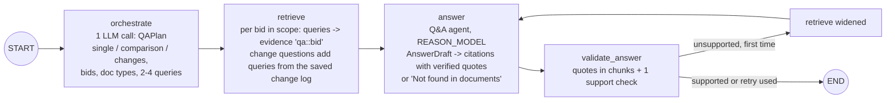

- Comparison questions get evidence per bid and the prompt asks for a
  side-by-side answer citing each bid.
- Change questions ("what changed in Addendum 2") also load the bid's saved
  `addendum_changes` and derive extra queries from them (old value ->
  original passage, new value -> addendum passage), raising the evidence
  cap so both sides survive the merge.
- An answer that is still unsupported after the widened retry becomes
  "Not found in documents" rather than an unsupported claim.

---

## 12. Observability: the trace

`@log_step(agent, node)` wraps every node. For each node execution it writes
one `StepLog` line to `logs/trace_<run_id>.jsonl` and appends it to the
state's `usage` list:

```json
{"run_id": "...", "step": 10, "agent": "Validator", "node": "validate",
 "started_at": "2026-10-10T09:04:57.102+00:00",
 "input_summary": "run_id='...', bid_ids=list[1], evidence=dict[18], drafts=dict[19], ...",
 "tool_calls": [{"kind": "llm", "model": "gpt-5.4-mini", "tokens_in": 3900, "tokens_out": 210, "cost_usd": 0.0039, "latency_ms": 5200, "schema": "SupportChecks"},
                {"kind": "validation", "passed": 17, "failed": {"Bid Submission Type": "failed: supported"}, "to_retry": ["Bid Submission Type"]}],
 "output_summary": "validation=dict[19], drafts=dict[19], retries=dict[1], to_retry=list[1], widened=True",
 "tokens_in": 3900, "tokens_out": 210, "cost_usd": 0.0099, "latency_ms": 19034, "error": null}
```

Tool-call kinds: `search` (query, filters, hits), `index_bid`, `llm`
(model, tokens, cost, latency, schema), `validation`, `draft` and
`answer_check` (Q&A). A node that raises is caught: the error goes into the
StepLog and into `state["errors"]`, and the run continues with a safe
partial state. `GET /runs/{run_id}` and the web app's Run trace page read
this file; the CLI prints totals (steps, tokens, cost) after every run.

---

## 13. Services, CLI and API

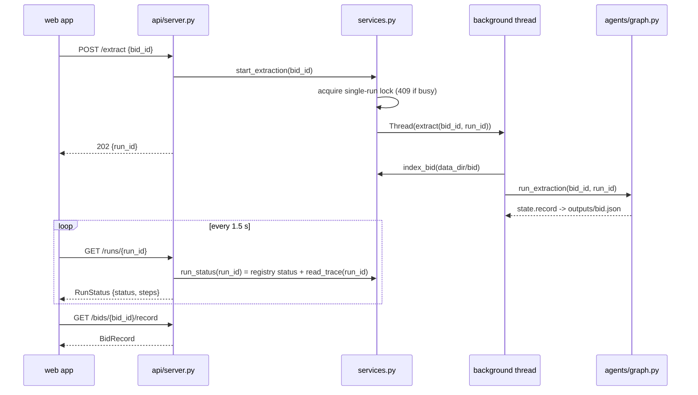

`services.py` functions and who uses them:

| function | CLI | API |
|---|---|---|
| `index_bid(folder, force)` | `index`, before extract/ask | `POST /index`, `POST /bids` |
| `search(query, bid_id, doc_type, addendum, top_k, config)` | `search` | `GET /search` |
| `extract(bid_id)` -> BidRecord | `--bid`, `extract`, `run` | background worker |
| `start_extraction(bid_id)` -> run_id | - | `POST /extract` (202 / 409) |
| `run_status(run_id)` | - | `GET /runs/{id}` |
| `list_runs()`, `active_run()` | - | `GET /runs` (newest first; the running one is what a 409 refers to) |
| `ask(question, bid_ids)` -> Answer | `ask`, `--ask` | `POST /ask` |
| `list_bids()`, `get_bid_detail()`, `get_record()` | - | `GET /bids`, `/bids/{id}`, `/bids/{id}/record` |
| `get_chunk(chunk_id)` | - | `GET /chunks/{id}` |
| `save_upload(bid_id, files)` | - | `POST /bids` (only .pdf/.html/.htm, id `^[A-Za-z0-9_-]{1,64}$`) |
| `safe_file_path(bid_id, name)` | - | `GET /files/{bid}/{file}` (rejects paths that escape the bid folder) |
| `eval_results(kind)` | - | `GET /eval/retrieval`, `/eval/extraction` |

API conventions: engine opened once in the lifespan; CORS from
`api.cors_origins`; every error is JSON `{"error": "...", "run_id": null}`
(400 validation, 404 missing, 409 busy, 422 bad body, 500 unexpected).

---

## 14. Error handling

| failure | where it is caught | effect |
|---|---|---|
| unreadable / empty / encrypted / scanned file | `loader.load_file` | Document with warning; run continues |
| unsupported extension, duplicate file | `loader.load_bid_folder` | skipped + logged |
| table extraction error | `pdf_parser._extract_tables` | warning; text still indexed |
| search error inside a node | `retrieve.run_request` | recorded as a search tool call with `error`; empty evidence |
| empty retrieval for a field | `extract` / `baseline.extract_group` | `not_found`, no LLM call |
| LLM timeout / API error / bad JSON after one retry | `llm.py` -> `LLMError` -> each node | extractor group -> every field `failed` with the error in notes; reconciler/validator -> drafts kept, error logged; summary -> failed; answer -> Not found |
| wrong API key | same path | run finishes with failed fields and a complete trace |
| node raises anything else | `@log_step` | error in StepLog + `state["errors"]`; safe partial state |
| validator failure | `validate` | retry (max 2) with widened retrieval, then status `failed`, confidence 0.2 |
| two extractions at once via API | `services.start_extraction` | 409 |
| path traversal on `/files` | `services.safe_file_path` | 400 |

Tests: `tests/test_error_handling.py`, `tests/test_ingestion_failures.py`, `tests/test_api.py`.

---

## 15. Evaluation

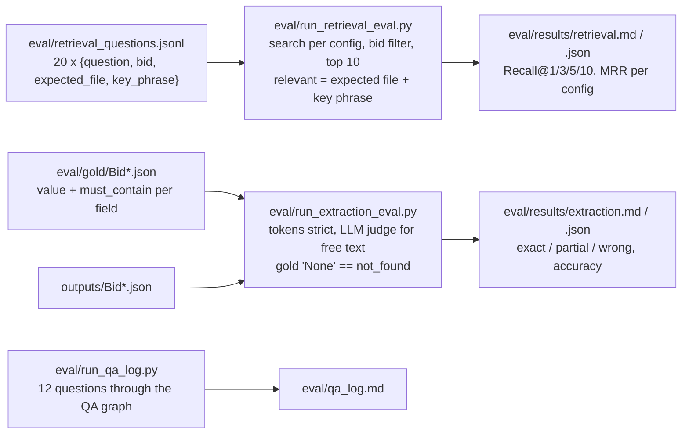

`eval/verify_eval_data.py` checks that every key phrase and gold token exists
in the real files before anything is scored.

---

## 16. Storage layout on disk

```
storage/
  manifest.json          {bid_id: {files: {name: sha1}, config: hash}, _dim: 384}
  qdrant/                Qdrant embedded collection 'rfp_chunks' (payload = Chunk)
  bm25/<bid>.pkl         chunks + tokens for the BM25 corpus of one bid
  llm_cache/             optional dev cache of LLM replies (LLM_DEV_CACHE=1)
outputs/
  parsed/<bid>/<file>.json   Documents from `parse`
  <bid>.json                 BidRecord (deliverable)
  <bid>_summary.md           summary paragraph + field table + change log
logs/
  trace_<run_id>.jsonl       one StepLog per node execution
```

---

## 17. Extending the backend

- **New field:** add an entry to `config/fields.yaml` (name, group,
  description, search_hints, optional doc_types) and a gold value to
  `eval/gold/*.json`. No code changes.
- **New document type:** add a pattern to `classifier` in
  `config/ingestion.yaml` and a member to `DocType`; precedence in
  `settings.yaml`.
- **New LLM provider:** implement the `Provider` protocol in `llm.py`
  (`complete(prompt, system, model, schema, schema_name) -> RawResponse`)
  and map it in `_provider()`.
- **New retrieval config:** add a name under `retrieval_configs` in
  `settings.yaml`; it is available to `--config`, `/search` and the eval.
- **New agent:** write a node function wrapped in `@log_step`, give its
  messages a Pydantic model in `schemas.py`, and wire it in `graph.py`.
  Only the Retrieval node may call `engine.search`.
